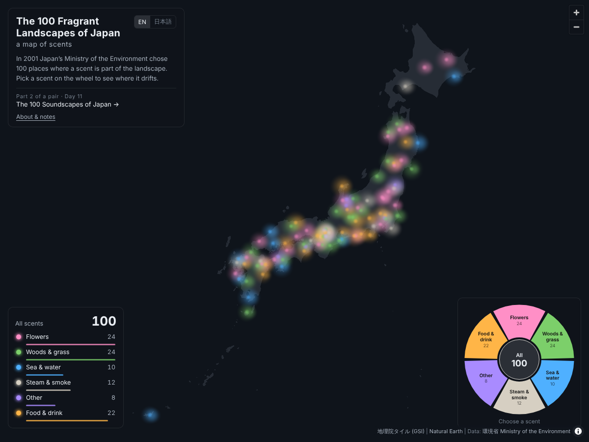

# The 100 Fragrant Landscapes of Japan: a map of scents

**日本のかおり風景100選 かおりの地図**

#30DayMapChallenge 2026 · Day 19 · Senses: Smell

**Live map:** https://shinyanakashima.github.io/30daymapchallenge-2026day19-100fragrances/

On 30 October 2001, Japan's Ministry of the Environment selected the *100 Fragrant Landscapes of Japan* (かおり風景100選) from 600 entries: places where a good scent belongs to the scenery, culture or daily life, and where local people work to keep it. Lavender fields and plum groves sit on the list next to hot spring sulphur, incense, soy sauce, old books and the smell of rain on stone.

This map places the 100 scents as soft, drifting hazes coloured by the kind of scent. Pick a kind on the scent wheel and its places come forward while the rest fade.

It is the second half of a pair with Day 11, [The 100 Soundscapes of Japan: a sound calendar](https://shinyanakashima.github.io/30daymapchallenge-2026day11-100soundscapes/). Day 11 shows sounds by *when* you can hear them; this map shows scents by *what* they smell of.

- Scent wheel with six kinds of scent; the counts are also listed in the bottom-left corner
- Click a haze for its name, place, kind of scent, season and a short description
- English and Japanese (`?lang=ja`); a kind of scent can be set with `?scent=flower` (`green`, `water`, `smoke`, `food`, `other`)
- Keyboard: ← / → move around the wheel, 0 shows all, Esc closes
- The hazes stop moving when the device is set to reduce motion

### Counts

| Kind of scent | Items |
|---|---|
| Flowers | 24 |
| Woods & grass | 24 |
| Food & drink | 22 |
| Steam & smoke | 12 |
| Sea & water | 10 |
| Other | 8 |

Hokkaido has 4 (Furano lavender, Kitami mint, Noboribetsu Jigokudani, Kushiro sea fog).

## Kinds of scent

Each item has one main kind (`category`), chosen from its name and the scent sources on its official page. Items with more than one scent also list the others (`category_also`, 33 items), but are counted once, under the main kind.

| Kind | `category` | What goes in it |
|---|---|---|
| Flowers 花 | `flower` | Flowers and herbs, and fruit trees where the blossom is named (peach, mandarin and natsumikan blossom) |
| Woods & grass 木・森・草 | `green` | Trees, forests, shrine groves, timber, moss, grassland, wetland plants and rice terraces |
| Sea & water 海・水辺 | `water` | Tide, rocky shores, sea fog, harbours and wind over a river |
| Steam & smoke 湯けむり・煙 | `smoke` | Hot springs and sulphur, incense, kilns, a peony bonfire and candles |
| Food & drink 食べ物・飲み物 | `food` | Crackers, cooking and markets, fruit, tea, sake, vinegar and soy sauce |
| Other そのほか | `other` | Old books, ink sticks, animal glue, herbal medicine, face powder, indigo dye, candle making and rain on hot stone |

Rules for mixed entries: the main kind is the scent the title puts first (e.g. No. 20 *wisteria and incense* → Flowers; No. 26 *incense and rocky shore* → Steam & smoke). Where the title does not name a scent, the first scent source on the official page is used (e.g. No. 51, salted wakame making, whose source is “sea, seaweed” → Sea & water). Orchards are Flowers when the page names the blossom, and Food & drink when it names the fruit or both (No. 41 apples, No. 75 citrus, No. 95 kabosu).

## Data

`data/fragrances.json` holds one record per place. Field names follow the Day 11 data (`data/soundscapes.json`) so both lists can be read the same way.

| Field | Content |
|---|---|
| `id` | Number in the official list (1–100) |
| `name_ja` / `name_en` | Name in Japanese / English (English written for this map) |
| `prefecture_ja` / `prefecture_en` | Prefecture |
| `municipality_ja` / `municipality_en` | Municipality, current name after mergers |
| `municipality_listed_ja` | Municipality as written in the 2001 list |
| `lat` / `lon` | Representative point (WGS84) |
| `location_type` | `point` = the site itself, `area` = representative point of a town, coast, forest, farming area or district |
| `location_note_ja` | What the point stands for |
| `category` | Main kind of scent (see above) |
| `category_also` | Other kinds of scent at the same place |
| `scent_source_ja` | “かおりの源” (source of the scent) from the official page |
| `months` | Months when the scent is there (1–12) |
| `all_year` | `true` if all year |
| `months_basis_ja` | “季節” (season) from the official page |
| `months_estimated` | `true` if the months were read from words such as “spring” or “autumn” |
| `description_ja` / `description_en` | Short description written for this map (1–2 sentences) |

`data/japan-land.geojson` is the land outline of Japan extracted from Natural Earth 1:10m countries (same file as Day 11).

### How the data was made

1. **List**: number, prefecture, municipality and name were taken from the table on the Ministry of the Environment list page (`ichiran.htm`). The selection date (30 October 2001) and the number of entries (600) come from the Ministry's press release.
2. **Entry pages**: for each of the 100 entries, the linked page was read for its location, source of scent (かおりの源) and season (季節).
3. **Municipalities**: names in the 2001 list were updated to current municipalities after the mergers of the 2000s (e.g. 尾上町 → 平川市, 宮島町 → 廿日市市). The original wording is kept in `municipality_listed_ja`.
4. **Coordinates**: the site or district was looked up with the GSI address and place-name search (msearch.gsi.go.jp) and, for a few sites missing there, OpenStreetMap. Every point was then checked with the GSI reverse geocoder, and all 100 fall in the expected current municipality. Towns, coasts, forests, farming areas and lists of several municipalities use one representative point (`location_type: area`, 65 items). Where the exact site could not be confirmed (No. 6, 9, 65, 81), the point is the district the site is in and is marked `area`.
5. **Seasons**: “一年中” (all year) became 12 months. Month ranges were taken as written. Seasons given only as words were converted (spring = Mar–May or the part that fits the plant, summer = Jun–Aug, autumn = Sep–Nov or the part that fits, winter = Dec–Feb, “spring to autumn” = Apr–Oct) and marked as estimated (24 items). Places where one scent is there all year and another only in season (No. 20, 40, 62, 90) are marked all year, with the details kept in `months_basis_ja`.
6. **Kinds of scent**: assigned as described above.
7. **Descriptions and English names**: written for this map. Photos and text from the Ministry's pages are not reproduced.

## Notes

- The list was selected in 2001. Some places may no longer smell the same today.
- Points are representative locations.
- The kinds of scent are a guide, assigned from each name and its description.
- Seasons are a guide, based on the official pages.

## Sources

- Ministry of the Environment, Japan. かおり風景100選 (list and entry pages). https://www.env.go.jp/air/kaori/ichiran.htm
- Ministry of the Environment, Japan. かおり風景１００選の選定について (press release, 30 October 2001). https://www.env.go.jp/press/2941.html
- Base map: 地理院タイル 白地図 (GSI Tiles, blank map), Geospatial Information Authority of Japan. https://maps.gsi.go.jp/development/ichiran.html
- Base map: Natural Earth (public domain), via world-atlas 2.0.2. https://www.naturalearthdata.com/
- Coordinates checked with the GSI address search and reverse geocoder; a few sites located with © OpenStreetMap contributors.
- Map library: MapLibre GL JS 4.7.1

---

## 日本語

2001年10月30日、環境省は全国600件の応募から「かおり風景100選」を選びました。ラベンダー畑や梅林と並んで、温泉の硫黄、線香、醤油、古書、雨上がりの石のにおいまでが選ばれています。
この地図では100のかおりを、ふわりと漂う霞としてかおりの種類ごとの色で置きました。「かおりの輪」から種類を選ぶと、そのかおりの場所が濃く浮かび、ほかは薄くなります。

Day 11「[日本の音風景100選 音の暦](https://shinyanakashima.github.io/30daymapchallenge-2026day11-100soundscapes/?lang=ja)」と対になる2部作の後編です。Day 11 は音を「いつ聞けるか」で、この地図はかおりを「どんなかおりか」で見せます。

- 6つのかおりの種類を選べる輪。種類ごとの件数は左下にも表示
- 霞をクリックすると、名称、場所、かおりの種類、季節、短い説明を表示
- 英語と日本語の切り替え（`?lang=ja`）
- 「動きを減らす」設定の端末では霞の揺らぎを止めます

### かおりの種類の分け方

| 種類 | 件数 | 含めたもの |
|---|---|---|
| 花 | 24 | 花・ハーブ。果樹は紹介ページが花を挙げているもの |
| 木・森・草 | 24 | 樹木・森林・社叢・材木・苔・草原・湿原の植物・棚田 |
| 食べ物・飲み物 | 22 | せんべい・料理・市場・果実・茶・酒・酢・醤油 |
| 湯けむり・煙 | 12 | 温泉と硫黄・線香とお香・窯・牡丹焚火・ろうそく |
| 海・水辺 | 10 | 潮・磯・海霧・港・川を渡る風 |
| そのほか | 8 | 古書・墨・にかわ・和漢薬・おしろい・藍・和ろうそくづくり・雨上がりの石 |

名称と紹介ページの「かおりの源」から主なかおりを1つ決めました。複数のかおりがあるものは名称で先に挙がっているかおり（名称にかおりが無いものは「かおりの源」の最初のもの）を主とし、ほかのかおりは `category_also` に入れています（33件）。北海道は4件です。

### データの作り方

1. 環境省「かおり風景100選」一覧表から番号・都道府県・市町村・名称を取りました。選定日（2001年10月30日）と応募数（600件）は報道発表資料によります。
2. 各地点の紹介ページから、所在地・かおりの源・季節を読みました。
3. 市町村は合併後の現在の名称にし、一覧表の表記は `municipality_listed_ja` に残しました。
4. 緯度経度は、国土地理院の地名・住所検索（一部は OpenStreetMap）で場所を探し、すべての点を国土地理院の逆ジオコーダで現在の市町村と照合しました。町・海岸・森・農地・複数市町村にまたがるものは代表点です（65件）。施設の位置を確かめきれなかったもの（No. 6、9、65、81）は、その施設がある地区の代表点としています。
5. 季節は紹介ページの「季節」を月に直しました。「春」「秋」など言葉だけのものは「推定」としています（24件）。
6. 説明文と英語名はこの地図のために書いたものです。紹介ページの写真や文章は転載していません。

### 注記

- 100選は2001年の選定です。今も同じようにかおるとは限りません。
- 地点は代表点です。
- かおりの種類は、名称と説明から分けた目安です。

### 出典

- 環境省「かおり風景100選」（一覧表・各地点の紹介ページ）、報道発表資料「かおり風景１００選の選定について」（2001年10月30日）
- 背景地図：地理院タイル（白地図）、Natural Earth

## License

Code: MIT. Data compiled from the sources above; descriptions in `data/fragrances.json` are original summaries.
